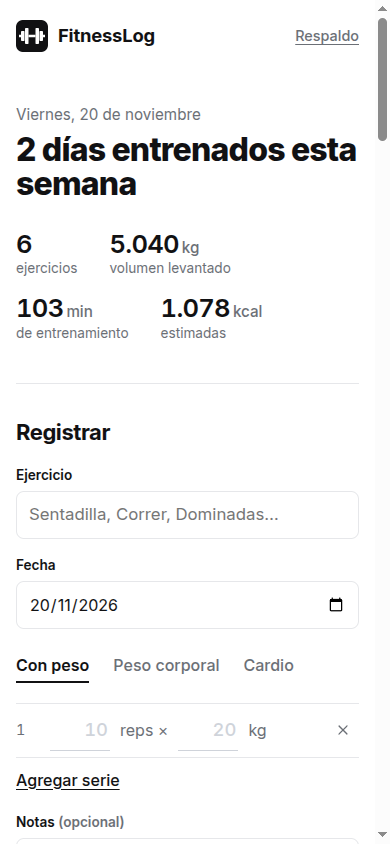
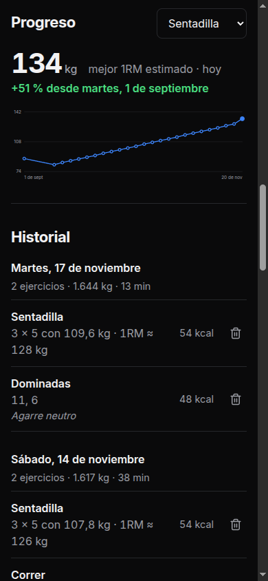
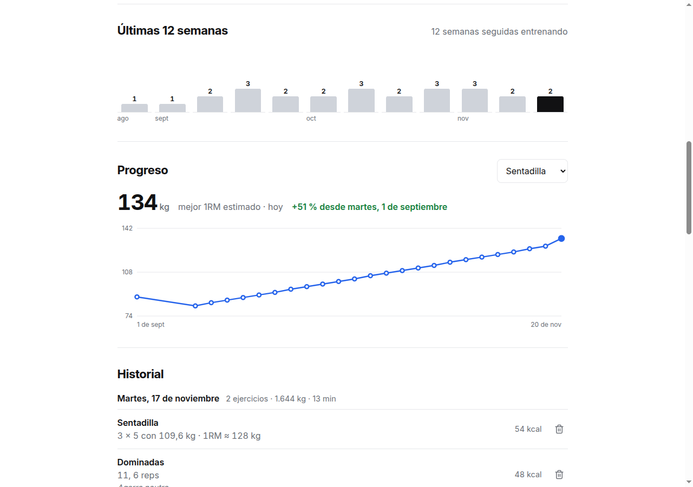

# FitnessLog

Bitácora de entrenamiento que funciona en el navegador, sin registro y sin conexión. Anotas cada serie y la app te muestra tus récords, tu 1RM estimado, tu progreso por ejercicio y cuántos días entrenaste cada semana.

**Pruébala:** https://eliasgdev.github.io/fitness-log/

<p>
  
  
</p>



## Qué hace

- **Registro por series.** Con peso (repeticiones × kg), peso corporal (con lastre opcional) o cardio (minutos y distancia). Al escribir el ejercicio te recuerda lo que hiciste la última vez y precarga esas series.
- **Récords.** Al guardar, avisa si superaste tu mejor 1RM estimado, tu peso máximo, tus repeticiones seguidas o tu distancia.
- **Progreso.** Gráfica por ejercicio con el mejor valor de cada día y el cambio porcentual desde el primer registro.
- **Constancia.** Días entrenados por semana en las últimas 12 semanas y racha de semanas seguidas.
- **Resumen semanal.** Ejercicios, volumen levantado, minutos y calorías estimadas.
- **Tus datos son tuyos.** Todo vive en `localStorage`; puedes descargar un respaldo JSON y cargarlo en otro dispositivo. Borrar algo siempre se puede deshacer.
- **App instalable.** PWA que abre sin conexión, con modo oscuro automático.

## Cómo se calcula

| Qué | Cómo |
|---|---|
| 1RM estimado | Fórmula de Epley: `kg × (1 + reps / 30)`. Solo con 12 repeticiones o menos, porque más allá deja de ser fiable. |
| Calorías | `MET × peso corporal (kg) × horas`, con los MET del Compendium of Physical Activities (2024). |
| Correr y caminar | Si anotas la distancia, el MET sale de la velocidad con las ecuaciones metabólicas del ACSM. |
| Tiempo de una sesión de fuerza | 2,5 minutos por serie, contando el descanso. |

Son estimaciones orientativas. Las calorías solo aparecen si anotas tu peso en Ajustes.

## Tecnología

- HTML, CSS y JavaScript con módulos ES, sin frameworks ni dependencias.
- Lógica pura en `js/calculos.js`, probada con `node:test`.
- Política de seguridad de contenido (CSP) estricta: sin scripts ni estilos en línea y sin `innerHTML`. Todo se construye con nodos del DOM.
- Los respaldos importados se validan entrada por entrada; lo que no cumple se descarta y se informa.
- Migra automáticamente los datos de la versión anterior (clave `fitnesslog`).

```
index.html          Estructura
css/styles.css      Estilos (claro y oscuro)
js/app.js           Interfaz
js/calculos.js      1RM, calorías, récords, progreso, validación y migración
js/catalogo.js      Ejercicios comunes con su tipo y MET
js/almacen.js       localStorage, respaldo e importación
sw.js               Service worker (sin conexión)
tests/              Pruebas
```

## Correrla en local

```bash
git clone https://github.com/eliasgdev/fitness-log.git
cd fitness-log
npm start      # http://localhost:8080
npm test       # Node 22 o superior
```

Cada cambio en `main` se prueba y se publica en GitHub Pages con GitHub Actions.

## Origen

Nació como un ejercicio de JavaScript y se rehízo aplicando las prácticas de calidad, seguridad y diseño que he ido consolidando en proyectos privados.

## Licencia

MIT. La fuente Inter se distribuye bajo la SIL Open Font License (`fonts/LICENSE-Inter.txt`).
